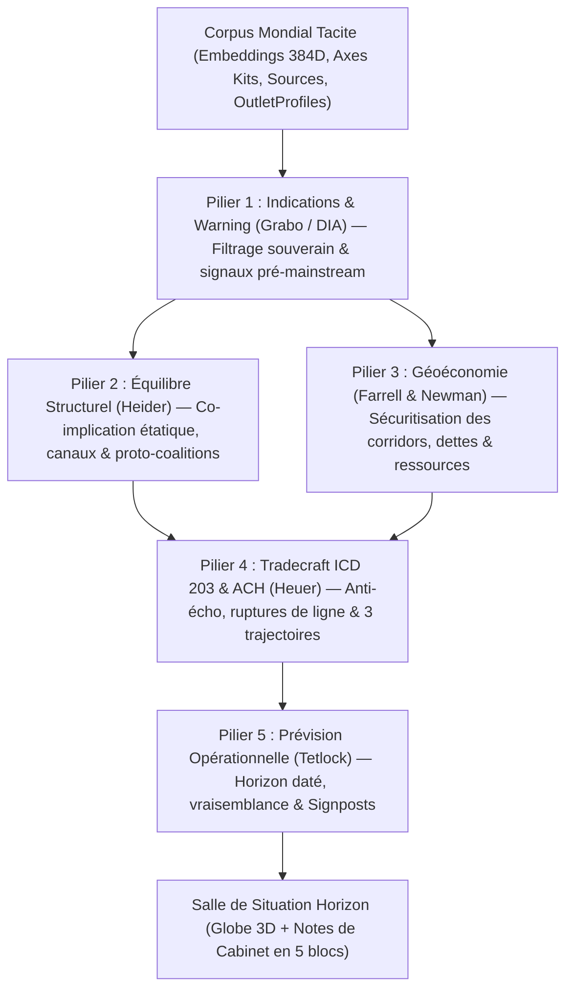

# TACITE HORIZON — DOCTRINE D'ANALYSE GÉOPOLITIQUE, GÉOÉCONOMIQUE & DE PRÉVISION STRATÉGIQUE

Document de référence doctrinal, méthodologique et algorithmique du module **Horizon** au sein de la plateforme **Tacite**.  
Il définit les fondements théoriques, les règles de filtrage souverain, les équations de détection trans-linguistique, le protocole de prévision opérationnelle, la grammaire visuelle de la Salle de Situation et l'architecture d'industrialisation (« en dur »).

---

## PARTIE 1 — VOCATION ET RUPTURE AVEC LA VEILLE MÉDIATIQUE

### 1.1 Articulation entre Tacite Socle (*Press Intelligence*) et Tacite Horizon (*Strategic Intelligence & Forecasting*)

Tacite repose sur un avantage structurel rare : un corpus mondial multilingue collecté en continu, dans lequel chaque article est vectorisé dans un espace sémantique commun (`384D`), qualifié par type de source, scoré sur une couche politique universelle (`loyalty`, `pluralism`, `openness`, `economy`, `order`) augmentée de kits de clivages régionaux, et rattaché à la ligne empirique habituelle de son média (`OutletProfile`).

À partir de cette même matière première, les deux étages de Tacite répondent à deux missions distinctes :

| Dimension | Tacite Socle (*Press Intelligence*) | Tacite Horizon (*Strategic Intelligence & Forecasting*) |
|---|---|---|
| **Question centrale** | *« Qui construit quel récit dans la presse, avec quelle influence, et quels leviers activer pour un client ? »* | *« Quelles décisions étatiques, militaires, diplomatiques ou géoéconomiques se préparent dans le monde avant leur annonce officielle ? »* |
| **Objet observé** | L'environnement informationnel (médias, journalistes, cadrages, campagnes, cibles de pitch). | Le système international réel (États, coalitions, corridors maritimes, sanctions, chaînes de valeur critiques), lu à travers le capteur avancé de la presse mondiale. |
| **Unité de sortie** | Fiche média/journaliste, cartographie d'influence, note d'analyse presse et plan d'action communication. | **Dossier de Salle de Situation** centré sur une **prévision opérationnelle datée** (`14 j`, `30 j`, `60 j`), ses scénarios, ses indicateurs de basculement (*Signposts*) et son enjeu souverain. |
| **Destinataire type** | Direction de la communication stratégique, affaires publiques, cellule d'influence. | Cabinet ministériel, État-major, diplomatie, renseignement d'intérêt économique, direction générale ou fonds souverain. |

### 1.2 La règle cardinale côté décideur : Zéro « Météo de Presse »

L'écueil mortel des plateformes d'OSINT automatisées consiste à livrer au client la cuisine statistique du moteur plutôt qu'une intelligence décisionnelle. Un ministre, un directeur de la stratégie ou un officier de veille n'a aucun usage d'une phrase telle que : *« 14 médias français parlent de l'Italie sur un ton de -0,24 (+18 % d'articles), probabilité 27 % »*.

Dans Horizon, **quatre interdictions absolues** gouvernent toute sortie visible par l'utilisateur :

1. **Interdiction du jargon métrique à l'écran** : aucun score de tonalité (`-0,24`), aucun seuil brut (`0,32`), aucun comptage mécanique d'articles ou de médias dans le corps des notes exécutives, aucun pourcentage pseudo-précis non étalonné (`71,4 %`). Les mathématiques tournent dans le moteur pour filtrer, classer et qualifier ; l'écran ne parle que le langage de la décision politique, militaire, diplomatique et économique.
2. **Interdiction des faits divers et du bruit civil** : un accident ferroviaire, un tremblement de terre sans friction interétatique, une affaire municipale, un fait divers criminel, une compétition sportive ou un bulletin météo ne doivent **jamais** entrer dans la Salle de Situation, quel que soit leur volume médiatique mondial.
3. **Interdiction d'enfoncer des portes ouvertes** : résumer ce qui a déjà eu lieu hier n'apporte aucune valeur ajoutée. Chaque dossier doit formuler **le coup d'après** (recomposition de coalition, contournement de sanctions, verrouillage d'un détroit, ouverture d'un canal parallèle, riposte réglementaire ou militaire).
4. **Interdiction de confondre mention et relation bilatérale** : le fait que la presse d'un pays $A$ commente négativement un événement survenu dans un pays $B$ ne constitue jamais, à lui seul, une tension interétatique entre $A$ et $B$.

---

## PARTIE 2 — LES CINQ PILIERS DE LA DOCTRINE ANALYTIQUE ET PRÉDICTIVE

Horizon combine cinq cadres méthodologiques éprouvés du renseignement stratégique, de la théorie des relations internationales et de la prévision calibrée.

### 2.1 Pilier 1 — *Indications & Warning (I&W)* : Renseignement d'alerte précoce
*Référence fondatrice : Cynthia M. Grabo, « Anticipating Surprise: Analysis for Strategic Warning » (Defense Intelligence Agency / Center for Strategic Intelligence Research).*

- **Principe** : Les ruptures stratégiques (opération militaire, régime de sanctions, rupture d'alliance, défaut souverain, fermeture d'un corridor énergétique) ne surgissent pas du néant ; elles sont précédées de signaux préparatoires fragmentés visibles dans des presses régionales, spécialisées ou semi-officielles avant que les grands médias généralistes occidentaux ne s'en emparent.
- **Traduction dans Horizon** :
  - Le volume brut mondial est un indicateur **retardé** (il culmine *après* le choc). Le vrai signal d'alerte précoce combine **accélération sémantique nette** par rapport à la quinzaine précédente, **diversité géographique des rédactions** et **part encore minoritaire des médias généralistes à très haute influence** (`mainstream_share <= 0.50`).
  - **Ballons d'essai étatiques (*State Trial Balloons*)** : dans les écosystèmes médiatiques où l'axe `loyalty` (ou `party_line`, `kremlin`, `alignment`) est élevé, une inflexion soudaine du cadrage envers un acteur extérieur ou un dossier sensible n'est pas une opinion journalistique aléatoire ; c'est fréquemment la préparation de l'opinion domestique ou un signal diplomatique indirect envoyé à une autre capitale.
  - **Silences asymétriques** : lorsqu'un théâtre engageant directement un État $X$ est couvert par plusieurs presses étrangères indépendantes tandis que les médias à forte `loyalty` de $X$ restent muets ou purement descriptifs, ce décalage signale une retenue coordonnée ou un verrouillage de communication de crise.

### 2.2 Pilier 2 — Équilibre structurel, dyades et coalitions émergentes
*Références : Fritz Heider (Structural Balance Theory, 1946) ; Dorwin Cartwright & Frank Harary (1956) ; Joshua S. Goldstein (Conflict-Cooperation Scale, 1992).*

- **Principe** : Les relations internationales forment un graphe signé dynamique où les acteurs cherchent à réduire la « frustration structurelle » (*l'ennemi de mon ennemi tend à devenir mon partenaire tactique ; l'ouverture d'un canal bilatéral par un membre d'une alliance crée une tension immédiate avec ses alliés*).
- **Traduction dans Horizon** :
  - **Qualification des théâtres multi-acteurs** : Horizon n'extrait pas des paires pays-source / pays-cible naïves ; il identifie le **sous-ensemble d'États réellement co-impliqués** au cœur d'un même événement stratégique (poids cumulé dans les titres, les sujets et les entités géopolitiques du cluster).
  - **Détection des fissures d'alliance et proto-coalitions** : lorsqu'un groupe de $\ge 3$ États apparaît conjointement autour de sommets, d'appels bilatéraux directs brisant un isolement diplomatique (ex. initiatives nordiques vers Moscou critiquées par Varsovie ou Copenhague), de négociations en pays tiers (Abou Dhabi, Doha, Mascate, Téhéran) ou de pactes sectoriels, le moteur le classe en **Recomposition diplomatique / Coalition** et projette son enveloppe géométrique sur le globe.

### 2.3 Pilier 3 — Géoéconomie et *Weaponized Interdependence* (Interdépendance armée)
*Références : Henry Farrell & Abraham L. Newman, « Weaponized Interdependence: How Global Economic Networks Shape State Coercion » (International Security, 2019) ; École de Copenhague (Buzan, Wæver — Théorie de la Sécuritisation).*

- **Principe** : Dans la compétition contemporaine entre puissances, la coercition passe autant par les goulets d'étranglement économiques (détroits maritimes, gazoducs, semi-conducteurs, terres rares, chambres de compensation, sanctions secondaires, dette souveraine) que par la force cinétique. Avant qu'un État ne frappe économiquement, l'objet économique subit une **sécuritisation discursive** : il cesse d'être traité sous l'angle de la rentabilité de marché pour être cadré comme un enjeu de sécurité nationale ou de souveraineté.
- **Traduction dans Horizon** :
  - Surveillance permanente des **goulets d'étranglement physiques (`CHOKEPOINTS`)** : Détroit d'Ormuz, Bab el-Mandeb / Mer Rouge, Canal de Suez, Route Arctique / Groenland, Détroit de Taïwan, Détroit de Malacca, Canal de Panama.
  - Calcul de l'**empreinte géoéconomique sécuritisée** : croisement d'un lexique stratégique (tarifs, sanctions, embargos, dette souveraine, banques centrales, GNL/pétrole, minerais critiques, câbles/satellites) avec un **cadrage régalien** (`order <= -0.08` ou `openness <= -0.08`) et la présence de **sources étatiques** (`government`, `judicial`, `anonymous`). Dès que ce croisement franchit le seuil, le dossier bascule en **Géoéconomie & Corridors**.

### 2.4 Pilier 4 — Tradecraft du Renseignement (ICD 203) & Hypothèses Concurrentes (ACH)
*Références : ODNI, « Intelligence Community Directive 203 — Analytic Standards » ; Richards J. Heuer Jr., « Psychology of Intelligence Analysis » (CIA CSI, 1999).*

- **Principe** : Protéger le décideur contre deux biais cognitifs majeurs : l'**illusion de corroboration** (prendre 50 reprises d'une même dépêche pour 50 preuves) et la **clôture analytique prématurée** (ne présenter qu'un seul scénario linéaire).
- **Traduction dans Horizon** :
  - **Déflation stricte de l'écho médiatique** :
    1. Les doublons quasi-identiques (`articles.duplicate_of_id IS NOT NULL`, similarité cosinus $\ge 0,95$) sont écartés dès la requête SQL.
    2. La solidité d'un théâtre n'est jamais mesurée par le nombre brut d'articles $N_{\text{art}}$, mais par le produit logarithmique de la diversité des rédactions distinctes $N_{\text{outlets}}$ et des pays d'origine de la presse $N_{\text{press\_countries}}$.
  - **Poids diagnostique supérieur des Ruptures Éditoriales (*Frame Ruptures*)** : Horizon compare systématiquement le cadrage des articles d'un dossier à la ligne empirique habituelle (`OutletProfile.real_classification`) de chaque média sur les axes `loyalty`, `openness`, `order`, `economy`, `international` et `alignment`. Un écart $|\Delta| \ge 0,32$ est extrait et signalé explicitement dans la fiche (*Inflexions éditoriales inhabituelles*) : un journal qui parle *contre* son réflexe idéologique habituel fournit un signal diagnostique beaucoup plus fort que dix journaux répétant leur ligne attendue.
  - **Trois trajectoires obligatoires (ACH)** : chaque Note de Cabinet présente systématiquement trois trajectoires distinctes :
    1. *Trajectoire centrale retenue* ;
    2. *Gestion sous seuil / marchandage intermédiaire* ;
    3. *Basculement rapide (rupture haute ou désamorçage)*.

### 2.5 Pilier 5 — Prévision opérationnelle calibrée (*Superforecasting*)
*Références : Philip E. Tetlock & Dan Gardner, « Superforecasting: The Art and Science of Prediction » ( programme IARPA ACE ) ; Sherman Kent (doctrine de l'estimative).*

- **Principe** : Une prévision utile à l'action doit être **datée**, **spécifique**, **vérifiable dans le monde réel** et assortie d'**indicateurs d'alerte observables (*Signposts*)** permettant de savoir en temps réel si l'on s'en rapproche ou si l'on s'en éloigne.
- **Traduction dans Horizon** :
  - **Horizon temporel explicite** adapté à la cinétique du phénomène :
    - `14 jours` pour un **Signal précurseur** en forte accélération pré-mainstream ;
    - `30 jours` pour une **Escalade sécuritaire** ou une **Pression géoéconomique / corridor** ;
    - `60 jours` pour une **Recomposition diplomatique / coalition**.
  - **Qualification verbale disciplinée (sans fausse précision numérique en façade)** :
    - **Probable** (*Likely*) : convergence multi-pays élevée, forte accélération par rapport à la base, forte densité de sources régaliennes et/ou ruptures éditoriales ;
    - **Possible** (*Possible*) : dynamique transfrontalière avérée et mécanisme causal crédible, mais encore dépendante d'arbitrages politiques ouverts ;
    - **Sous surveillance** (*Watchlist*) : signal structurel faible ou émergent sur un corridor ou théâtre critique justifiant une veille active avant confirmation.
  - **Double *Signpost* systématique** : chaque dossier énonce explicitement :
    - *Confirme le basculement si…* (l'acte exécutif, militaire, parlementaire ou réglementaire précis qui valide le scénario central) ;
    - *Désamorce / invalide si…* (l'accord technique, le retrait, le démenti coordonné ou le verrouillage institutionnel qui referme le risque).

---

## PARTIE 3 — PIPELINE MATHÉMATIQUE ET ALGORITHMIQUE DÉTAILLÉ

Cette section documente la chaîne exacte exécutée par `backend/app/services/horizon.py` sur la base Tacite existante.

### 3.1 Fenêtrage temporel et extraction sans fuite du futur

Soit $T_{\text{end}}$ la date de lecture demandée (`as_of`, ou par défaut $\max(\text{published\_at})$ du corpus). Horizon découpe deux fenêtres strictes sur les articles au statut `analysis_status = 'analyzed'`, munis d'un vecteur `embedding IS NOT NULL` et originaux (`duplicate_of_id IS NULL`) :

- **Fenêtre active** $\mathcal{W}_{\text{recent}} = (T_{\text{end}} - 14\text{ j},\; T_{\text{end}}]$ ;
- **Fenêtre de base (référence historique)** $\mathcal{W}_{\text{base}} = [T_{\text{end}} - 28\text{ j},\; T_{\text{end}} - 14\text{ j})$.

Aucune donnée postérieure à $T_{\text{end}}$ n'est lue, ce qui garantit l'intégrité du curseur de relecture historique et des backtests *walk-forward*.

### 3.2 Porte de gravité souveraine (`_is_sovereign_relevant`)

Un article $a$ de titre $t_a$ et de métadonnées extraites $d_a$ (`topics`, `entities`, `framing`, `sources`) est admis dans le calcul si et seulement si :

1. Ses libellés de sujets ne sont pas tous dans `JUNK_TOPICS` (`non-political`, `boilerplate`, `hors champ`, `غير سياسي`, etc.).
2. Le texte agrégé $B_a = t_a \oplus \text{topics}_a \oplus \text{orgs}_a \oplus \text{locations}_a$ **ne matche aucun motif d'exclusion civile** `INCIDENT_RE` (collisions de trains/avions/routes, séismes/typhons/inondations, météo, sport, célébrités, fiscalité immobilière domestique, grèves sectorielles purement internes, faits divers criminels).
3. Il satisfait au moins l'une des deux conditions de gravité :
   - **Condition lexicale souveraine** : $B_a$ matche `SOVEREIGN_RE` (sanctions, tarifs, banques centrales, dette souveraine, OTAN/BRICS/OPEP/CPI/ONU/UE, frappes/missiles/trêves/sommets, renseignement/sabotage/nucléaire, détroits stratégiques, hydrocarbures/minerais critiques/semi-conducteurs, exécutifs et diplomaties) ;
   - **Condition d'énergie axiale régalienne** : l'énergie géopolitique cumulée sur les axes de cadrage vérifie :
     $$E_{\text{strat}}(a) = \sum_{k \in \mathcal{K}_{\text{strat}}} |\text{framing}_a(k)| \ge 0,55$$
     où $\mathcal{K}_{\text{strat}} = \{\text{international}, \text{alignment}, \text{openness}, \text{order}, \text{economy}, \text{europe}, \text{sovereignty}, \text{us\_rivalry}, \text{kremlin}\}$, avec au moins une source institutionnelle/experte (`government`, `anonymous`, `judicial`, `political_party`, `expert`) et au moins une entité géographique extraite.

### 3.3 Résolution multilingue des acteurs souverains (`_extract_actors`)

Les entités géopolitiques extraites dans 8+ langues (ex. *« États-Unis », « Washington », « Weißes Haus », « Stany Zjednoczone », « الولايات المتحدة »*) sont projetées vers leur code État ISO 3166-1 alpha-2 via un automate lexical normalisé sans diacritiques (`_ALIASES` + `countries.json`, trié par longueur décroissante pour éviter toute collision de préfixe comme *Niger* vs *Nigeria*).

Pour chaque article $a$, chaque État détecté $c$ reçoit un poids de centralité :
- $+2$ s'il apparaît dans le **titre** ou les **sujets principaux** (`topics`) ;
- $+1$ s'il apparaît dans les **lieux** (`entities.locations`) ou **organisations** (`entities.organizations`).

Seuls les articles impliquant au moins un acteur étatique résolu poursuivent le pipeline.

### 3.4 Clustering sémantique trans-linguistique (`384D`)

Les vecteurs `paraphrase-multilingual-MiniLM-L12-v2` des articles retenus (plafond `CLUSTER_ART_CAP = 5500` par passe) sont normalisés sur l'hypersphère unité ($\hat{v}_a = v_a / \|v_a\|_2$).

Un regroupement hiérarchique agglomératif par **liaison moyenne (*average linkage*)** sur la distance cosinus $d(a,b) = 1 - \hat{v}_a \cdot \hat{v}_b$ coupe le dendrogramme au seuil `CLUSTER_DIST = 0.25` (soit une **similarité cosinus moyenne intra-cluster $\ge 0,75$**).  
Ce seuil permet de fusionner dans un unique dossier stratégique une dépêche d'*ANSA* en italien, une analyse de *Die Welt* en allemand, un papier d'*Al-Ittihad* en arabe et un article d'*Onet* en polonais traitant de la même manœuvre diplomatique ou militaire.

**Conditions d'admission d'un cluster $C$** :
- $|C| \ge 4$ articles souverains non-doublons sur 14 jours ;
- $N_{\text{outlets}}(C) \ge 3$ rédactions distinctes ;
- $N_{\text{press\_countries}}(C) \ge 2$ pays de publication distincts ;
- Identification des **acteurs étatiques pivots** $\mathcal{A}(C)$ : États dont le poids cumulé dans le cluster atteint $\ge \max(3,\; \lfloor 0,30 \cdot |C| \rfloor)$. Un cluster à acteur unique purement domestique sans composante géoéconomique transfrontalière est rejeté.

### 3.5 Mesure d'accélération, sources régaliennes et ruptures éditoriales

Pour chaque cluster valide $C$ :

1. **Centroïde et Vélocité ($J-14$ vs $J-28$)** :  
   On calcule le centroïde normalisé $\hat{\mu}_C = \frac{\sum_{i \in C} \hat{v}_i}{\|\sum_{i \in C} \hat{v}_i\|_2}$ et on compte dans la fenêtre précédente $\mathcal{W}_{\text{base}}$ le nombre d'articles $N_{\text{prev}}(C) = \big|\{b \in \mathcal{W}_{\text{base}} : \hat{v}_b \cdot \hat{\mu}_C \ge 0,72\}\big|$.  
   Le ratio d'accélération lissé vaut :
   $$\text{Accel}(C) = \frac{|C| + 1,0}{N_{\text{prev}}(C) + 1,5}$$

2. **Part des sources régaliennes (`regal_share`)** :  
   Proportion des sources citées dans $C$ appartenant aux catégories `government`, `anonymous` ou `judicial` :
   $$R_{\text{regal}}(C) = \frac{N_{\text{gov}} + N_{\text{anon}} + N_{\text{jud}}}{\max\!\big(1,\; \sum_{s} N_s\big)}$$

3. **Part d'exposition mainstream (`mainstream_share`)** :  
   Proportion des rédactions du cluster ayant un `influence_score >= 65` :
   $$M(C) = \frac{|\{m \in \text{Outlets}(C) : I_m \ge 65\}|}{N_{\text{outlets}}(C)}$$

4. **Ruptures de ligne éditoriale (`ruptures`)** :  
   Pour chaque article $a \in C$ publié par le média $m$, on compare son vecteur de cadrage `framing` au dernier cliché hebdomadaire `OutletProfile.real_classification` de $m$ sur les axes régaliens/internationaux $x \in \{\text{loyalty}, \text{openness}, \text{order}, \text{economy}, \text{international}, \text{alignment}\}$.  
   Si $f_a(x) \ne 0$, $r_m(x) \ne 0$ et $|f_a(x) - r_m(x)| \ge 0,32$, une rupture éditoriale $(m,\; \text{pays}(m),\; x,\; \Delta = f_a(x) - r_m(x))$ est enregistrée.

### 3.6 Arbre de classification des 4 familles de dossiers et étalonnage

Chaque cluster est typé selon l'arbre de décision ordonné suivant :

1. **`economy` (Géoéconomie & Corridors — horizon `30 j`)** :  
   Présence d'un goulet d'étranglement maritime/stratégique (`CHOKEPOINTS`) dans le cluster **OU** part géoéconomique $\ge 40\%$ couplée à une sécuritisation ($R_{\text{regal}} \ge 0,20$ ou $\overline{\text{order}} \le -0,08$ ou $\overline{\text{openness}} \le -0,08$).
2. **`conflict` (Escalade sécuritaire — horizon `30 j`)** :  
   Marqueurs cinétiques, coercitifs ou hybrides explicites (*frappe, strike, attack, opération militaire, houthi, sanction, embargo, espion, sabotage*) **OU** tonalité/ordre nettement conflictuels ($\overline{\text{tone}} \le -0,14$ ou $\overline{\text{order}} \le -0,10$).
3. **`coalition` / `rapprochement` (Recomposition diplomatique & Canaux — horizon `60 j`)** :  
   Marqueurs diplomatiques structurants (*sommet, accord, BRICS, appel bilatéral direct, négociations de paix, trêve/cessez-le-feu*) **OU** ouverture mutuelle soutenue ($\overline{\text{openness}} \ge 0,22$ et $\overline{\text{tone}} \ge +0,05$ entre $\ge 2$ États).
4. **`signal` (Signal précurseur — horizon `14 j`)** :  
   Accélération rapide ($\text{Accel}(C) \ge 1,8$) alors que les grands médias à forte influence sont encore minoritaires ($M(C) \le 0,50$).

**Score composite de force prédictive et vraisemblance** :
$$S_{\text{indep}} = \ln\big(1 + N_{\text{outlets}}\big) \cdot \ln\big(1 + N_{\text{press\_countries}}\big)$$
$$S_{\text{mom}} = \min\!\big(1,5,\; \ln(1 + \text{Accel}(C))\big)$$
$$S_{\text{raw}} = 0,24 \cdot S_{\text{indep}} + 0,36 \cdot S_{\text{mom}} + 0,40 \cdot \big(1,8 \cdot R_{\text{regal}} + 0,25 \cdot \mathbb{I}[\text{ruptures} \ne \emptyset]\big)$$

- $S_{\text{raw}} \ge 1,95 \implies$ **`likely` (*Probable*)**
- $1,35 \le S_{\text{raw}} < 1,95 \implies$ **`possible` (*Possible*)**
- $S_{\text{raw}} < 1,35 \implies$ **`unlikely` (*Sous surveillance*)**

### 3.7 Déduplication multi-théâtres et équilibrage mondial

Pour empêcher qu'une seule crise médiatique majeure (ex. élections en Israël ou guerre en Ukraine) n'occupe 6 des 9 places de la Salle de Situation au détriment des signaux faibles énergétiques ou régionaux, la sélection finale applique trois passes :
1. **Passe 1 (Priorité Corridors)** : sélection prioritaire des clusters rattachés à des `CHOKEPOINTS` distincts actifs (jusqu'à 3 détroits/corridors).
2. **Passe 2 (Non-recouvrement des coalitions d'acteurs)** : tri par saillance stratégique décroissante ; un candidat est écarté s'il partage $\ge 2$ acteurs étatiques parmi ses 3 premiers avec un dossier déjà retenu, ou si son État pivot principal apparaît déjà 2 fois.
3. **Passe 3 (Quotas d'équilibre)** : garantie d'au moins 2 dossiers `economy` et 2 dossiers `coalition` lorsqu'ils existent dans les candidats qualifiés, pour un total plafonné à **9 dossiers exécutifs**.

---

## PARTIE 4 — ARCHITECTURE DE RÉDACTION EXÉCUTIVE (NOTE DE CABINET EN 5 BLOCS)

### 4.1 Structure immuable d'une fiche Horizon

Chaque dossier est restitué sous la forme d'une **Note de Cabinet** en 5 blocs numérotés, complétée par les preuves primaires :

| Bloc | Titre affiché (FR / EN) | Contenu analytique exigé |
|---|---|---|
| **En-tête** | Catégorie · Vraisemblance · Horizon · Titre · Pays | Titre géopolitique tendu (5–9 mots), badge de vraisemblance (*Probable / Possible / Sous surveillance*), échéance (`14 j / 30 j / 60 j`) et drapeaux des États impliqués. |
| **01** | **Prévision opérationnelle** | Une phrase unique commençant par l'échéance (*« Sous 30 jours, … »*), formulant l'événement politique, militaire, diplomatique ou réglementaire attendu. |
| **02** | **Lecture stratégique & signaux détectés** | 2 à 3 phrases expliquant la manœuvre réelle en coulisses (fracture d'alliance, levier asymétrique, contournement) + encadré dédié listant les **Inflexions éditoriales inhabituelles** détectées. |
| **03** | **Trajectoires possibles** | Exactement 3 cartes de scénarios nommées et décrites concrètement : *1) Trajectoire centrale* (mise en avant visuellement), *2) Gestion sous seuil / marchandage*, *3) Basculement / rupture*. |
| **04** | **Indicateurs de basculement (*Signposts*)** | Deux balises opérationnelles : **Confirme le basculement si** (acte concret validant la prévision) et **Désamorce / invalide si** (acte concret refermant le scénario). |
| **05** | **Enjeu souverain, énergétique & économique** | Conséquence directe pour un décideur (sûreté d'un corridor, risque de sanctions secondaires, cohésion OTAN/UE, approvisionnement critique) + **4 dépêches primaires multi-pays** cliquables. |

### 4.2 Synthèse IA bornée + Moteur de repli analytique métier

- Lors du calcul de la vue courante (`is_live`), chaque dossier sélectionné est synthétisé via un appel JSON compact sans jetons de réflexion bloquants (`deepseek-v4-flash` avec `enable_thinking: False` et timeout socket strict `httpx.Timeout(12.0, connect=4.0)`).
- **Résilience totale (0 panne, 0 phrase générique)** : si la passerelle LLM est coupée, lente ou limitée (HTTP 429/503) — ou lorsque l'analyste déplace le curseur temporel dans le passé —, `_fallback_brief` génère instantanément une analyse structurée spécialisée par sous-archétype métier (sécurité maritime mer Rouge/Golfe, canaux diplomatiques Moscou/Europe, sanctions CPI/extraterritorialité, recompositions post-électorales, Frontex/accords migratoires, pactes UE–Canada, frictions sécuritaires bilatérales) en injectant les dirigeants, institutions et ruptures éditoriales réels du cluster.
- Le résultat complet est persisté dans `PreparedView` (`horizon:v2:<YYYY-MM-DD>:llm`) : toutes les ouvertures de page suivantes répondent en **~10 millisecondes** sans aucun coût LLM.

---

## PARTIE 5 — GRAMMAIRE VISUELLE DE LA SALLE DE SITUATION

L'interface `HorizonPage.tsx` + `HorizonMap.tsx` occupe l'écran en plein cadre (`fullBleed`) et obéit à une sémiotique stricte :

1. **Double projection instantanée (`Globe 3D` ⇄ `Planisphère`)** :
   - **Globe 3D orthographique** (vue par défaut) : restitue fidèlement les continuités transcontinentales (Arctique, Mer Rouge–Golfe–Asie, Atlantique). Cliquer sur un dossier dans la colonne de droite **fait pivoter automatiquement le globe** pour centrer le théâtre concerné.
   - **Planisphère `Equal Earth`** : vision synoptique mondiale sans hémisphère caché.
2. **Code couleur sémantique unique** :
   - **Carmin (`#c45c56`)** : Escalade sécuritaire / friction coercitive (arcs animés rapides à tirets + flèche directionnelle) ;
   - **Vert sauge (`#3d7a62`)** : Canal diplomatique, ouverture bilatérale ou coalition en recomposition (arcs continus + enveloppe convexe souple translucide autour des groupes de $\ge 3$ États) ;
   - **Ambre / Or (`#d4a24c` / `#c4ae62`)** : Pression géoéconomique, corridors stratégiques (losanges pulsants sur les détroits) et signaux précurseurs (ondes radar concentriques).
   - **Neutralité du reste du monde** : un pays qui n'appartient à aucun dossier souverain actif reste strictement neutre (`palette.surface`), afin que l'œil capte les points chauds en moins de deux secondes.
3. **Double lecture `Situation` / `Prévision` et Frise Passé ↔ Futur** :
   - En mode **Prévision** (ou lorsque le curseur temporel glisse à droite d'aujourd'hui dans la zone de projection), les signaux de faible vraisemblance s'estompent au profit des trajectoires probables/possibles et les **échéances (`14 j`, `30 j`, `60 j`)** s'affichent directement en cartouche au milieu des arcs géodésiques.
   - À gauche d'aujourd'hui, le curseur permet de **rejouer l'état géopolitique passé** à n'importe quelle date du corpus.

---

## PARTIE 6 — PROTOCOLE DE BACKTESTING WALK-FORWARD & CALIBRATION (SCORE DE BRIER)

Pour industrialiser Horizon sur un corpus mondial de 600+ médias et améliorer scientifiquement ses seuils au fil des mois, la validation prédictive suit un protocole *Walk-Forward* sans triche :

1. **Coupe temporelle aveugle ($T_0$)** : pour une série de dates passées $T_0 \in \{t_1, t_2, \dots, t_M\}$, exécuter `_compute_dossiers(db, end=T_0)` (qui ignore par construction tout article publié après $T_0$).
2. **Association d'une probabilité interne de référence** à chaque palier verbal pour l'audit interne uniquement :
   - `likely` (*Probable*) $\leftrightarrow \hat{p} = 0,72$
   - `possible` (*Possible*) $\leftrightarrow \hat{p} = 0,45$
   - `unlikely` (*Sous surveillance*) $\leftrightarrow \hat{p} = 0,20$
3. **Vérification automatique ou assistée à $T_0 + H$** : à l'échéance ($H \in \{14, 30, 60\}\text{ j}$), rechercher dans les articles publiés sur $(T_0,\; T_0 + H]$ proches du centroïde $\hat{\mu}_C$ si le *Signpost* de confirmation ($o_k = 1$) ou d'invalidation/continuité ($o_k = 0$) s'est réalisé.
4. **Mesure du Score de Brier et décomposition de Murphy** :
   $$\text{BS} = \frac{1}{K} \sum_{k=1}^{K} (\hat{p}_k - o_k)^2 \quad (\text{objectif opérationnel : } \text{BS} < 0,18)$$
   Ajuster les poids $(0,24,\; 0,36,\; 0,40)$ et les seuils $(1,35,\; 1,95)$ de $S_{\text{raw}}$ pour minimiser l'erreur de calibration par famille (`conflict`, `coalition`, `economy`, `signal`).

---

## PARTIE 7 — ARCHITECTURE CIBLE D'INDUSTRIALISATION (« EN DUR »)

Le module livré fonctionne aujourd'hui de bout en bout sans migration SQL destructive (stockage dans `PreparedView`). Pour le passage à l'échelle industrielle sur le serveur de production mondial, les évolutions structurelles suivantes sont prévues :

1. **Calcul asynchrone dans `worker.py` (`_views_loop`)** : précalculer automatiquement la vue Horizon (`fr` et `en`) toutes les heures dans le worker afin que l'endpoint HTTP `GET /api/horizon` ne fasse jamais qu'une lecture JSON instantanée en base.
2. **Tables relationnelles dédiées (`models.py` avec `HasTenant` + RLS)** :
   - `horizon_dossiers` : identifiant stable d'un théâtre suivi dans le temps (centroïde vectoriel `Vector(384)`, acteurs ISO, catégorie, date de première détection, statut `active / confirmed / invalidated / archived`) ;
   - `horizon_snapshots` : historique hebdomadaire/quotidien de la vraisemblance, de l'accélération et des ruptures éditoriales d'un dossier (permettant d'afficher la trajectoire d'évolution d'une alerte sur plusieurs mois) ;
   - `horizon_outcomes` : journal de résolution à échéance ($o_k \in \{0, 1\}$, article preuve de réalisation, calcul continu du Score de Brier).
3. **Indexation vectorielle incrémentale (`pgvector` HNSW)** : remplacer le `scipy.pdist` en mémoire (calibré à `5500` articles) par un rattachement incrémental au fil de l'eau sur les centroïdes des `horizon_dossiers` actifs via un index HNSW cosinus PostgreSQL, permettant d'absorber 100 000+ articles par quinzaine en moins d'une seconde.
4. **Intégration transversale Tacite** :
   - Outils Assistant (`agent_tools.py` & `mcp_server.py`) : `list_horizon_forecasts`, `get_horizon_dossier` ;
   - Croisement automatique avec les dossiers `Client` (`sensitive_topics`, `narratives_counter`) pour alerter proactivement lorsqu'un risque géopolitique ou géoéconomique touche le secteur ou les pays d'un client ;
   - Export PDF 1-clic au gabarit exécutif de `reports.py`.
